# Lab 3 — Kết quả đo trước / sau

Sinh viên thanh toán học phí qua **Fee Service** (cổng 4001). Fee Service gọi **ngân hàng giả lập** (cổng 4002) để trừ tiền. Báo cáo này làm 4 tình huống sự cố giữa hai service, mỗi tình huống đo hai lần:

- **Trước**: bank-client ngây thơ (`--naive`). Mỗi request mở một kết nối mới, không timeout, không retry, mọi lỗi đều coi là "không rõ kết quả".
- **Sau**: bank-client bền vững. Connect timeout 1s, deadline 4s tính từ lúc nhận request, pool keep-alive tối đa 10 socket, tối đa 3 lần gọi dùng cùng `Idempotency-Key`.

Mỗi ảnh là output thật của lệnh ghi ở dòng `$` đầu ảnh. File log cùng tên nằm trong [`evidence/`](./Lab3/evidence).

## Cách đọc một ảnh

Mọi ảnh có cùng cấu trúc, từ trên xuống:

1. Dòng `#`: thời điểm chạy, phiên bản Node, `exit` (mã thoát của script).
2. Dòng `$`: lệnh đã chạy. Có `--naive` là bản "Trước".
3. Bảng **Chỉ số**: số liệu đo được. Mỗi tình huống bên dưới giải thích từng dòng của bảng này.
4. Các dòng **PASS** (xanh) và **FAIL** (đỏ): script tự chấm từng tiêu chí của đề.
5. Dòng cuối `x/y tiêu chí đạt`.

Bản "Trước" được kỳ vọng có dòng FAIL, vì đó là chỗ bản "Sau" sửa. Bản "Sau" phải toàn PASS và `exit=0`.

Thuật ngữ:

| Thuật ngữ | Ý nghĩa |
|---|---|
| `PAID` / `FAILED` / `PENDING` | Lệnh thanh toán đã trừ tiền xong / bị từ chối hoặc chắc chắn chưa trừ / không biết bank đã trừ hay chưa |
| 201 / 402 / 503 / 504 | Fee Service trả về: thành công / bank từ chối (vượt hạn mức) / bank không dùng được, chưa trừ tiền / không rõ kết quả, giữ PENDING |
| `Idempotency-Key` | Mã gửi kèm mỗi lần gọi bank (bằng mã lệnh, ví dụ `P1`). Bank nhận lại cùng mã thì trả kết quả cũ, không trừ tiền lần nữa |

---

## TH1 — Bank tắt

**Bối cảnh.** Ngân hàng đang bảo trì hoặc đã sập. Fee Service phải báo lỗi nhanh, không sập theo, và dùng lại được ngay khi bank sống lại.

**Thiết lập.** Lúc đầu bank chưa chạy. Script chỉ bật Fee Service.

**Script làm gì** (theo thứ tự các dòng trong bảng):

| Dòng trong bảng | Bước script thực hiện |
|---|---|
| `Bank tắt: POST` | Gửi 1 thanh toán 1.000đ khi bank tắt |
| `Bank tắt: GET /fees` | Ngay sau đó hỏi công nợ sinh viên, để biết Fee Service còn trả lời được không |
| `Fee Service còn sống` | Kiểm tra process Fee Service còn chạy |
| `Bank bật lại: POST (không restart Fee)` | Bật bank lên, gửi thanh toán tiếp, không khởi động lại Fee Service |
| `BANK_URL=:4999: POST` | Khởi động lại Fee Service trỏ tới cổng 4999 (không ai nghe), gửi thanh toán |

**Tiêu chí đạt:** bank tắt thì trả 503 trong dưới 1,5s với JSON `{error, paymentId, status}`; `GET /fees` vẫn 200; bank bật lại thì thanh toán 201; sai `BANK_URL` thì hành vi giống bank tắt.

**Trước** (`npm run scenario -- tc1 --naive`):

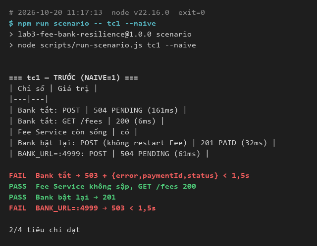

Đọc ảnh: `Bank tắt: POST` ra `504 PENDING (161ms)` và `BANK_URL=:4999: POST` ra `504 PENDING`, nên hai dòng FAIL tương ứng. Fee Service không sập (`Fee Service còn sống: có`). Lỗi nằm ở mã trả về. Kết nối bị từ chối (`ECONNREFUSED`) nghĩa là chắc chắn bank chưa trừ tiền, nhưng bản này coi mọi lỗi là "không rõ" nên giữ lệnh PENDING không cần thiết.

**Sau** (`npm run scenario -- tc1`):

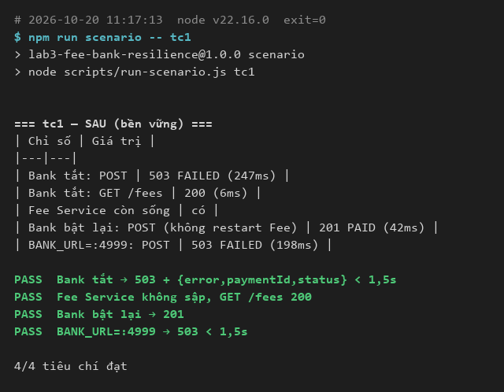

Đọc ảnh: cả hai dòng POST khi bank không dùng được đều ra `503 FAILED` trong 247ms và 198ms, dưới 1,5s. `Bank bật lại: POST` ra `201 PAID` mà không restart Fee Service, vì Fee Service không nhớ trạng thái "bank đã chết" giữa các request. 4/4 PASS.

---

## TH2 — Bank chậm

**Bối cảnh.** Bank vẫn sống nhưng mỗi request mất 5 giây mới trả lời. Fee Service không được treo người dùng quá 4,5s, và các chức năng khác (xem công nợ) không được chậm theo.

**Thiết lập.** Bank chạy với `DELAY_MS=5000`.

**Script làm gì:**

| Dòng trong bảng | Bước script thực hiện |
|---|---|
| `1 POST (bank DELAY_MS=5000)` | Gửi 1 thanh toán, đo thời gian đến khi nhận phản hồi |
| `20 POST đang chờ: GET /fees` | Gửi 20 thanh toán cùng lúc, chờ 500ms rồi hỏi công nợ, đo thời gian của lời gọi hỏi này |
| `20 POST: lâu nhất` | Thời gian của thanh toán chậm nhất trong 20 cái |
| `20 POST: mã trả về` | Các mã HTTP nhận được |

**Tiêu chí đạt:** thanh toán trả 504 PENDING và không quá 4,5s; `GET /fees` dưới 300ms khi 20 thanh toán đang chờ.

**Trước** (`npm run scenario -- tc2 --naive`):

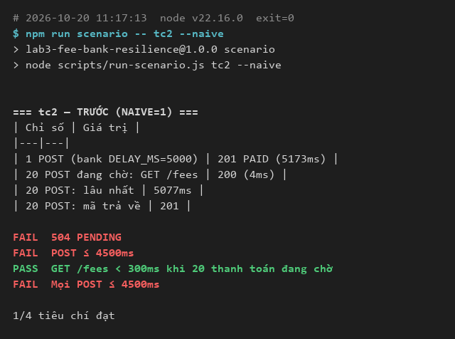

Đọc ảnh: `1 POST` ra `201 PAID (5173ms)`, tức chờ hết 5s của bank, vượt ngưỡng 4,5s nên có FAIL ở `504 PENDING` và hai dòng `≤ 4500ms`. Dòng `GET /fees < 300ms` vẫn PASS (4ms). Điều này không phải nhờ phần sửa: Node không bị chặn khi chờ I/O nên bản nào cũng trả lời nhanh.

**Sau** (`npm run scenario -- tc2`):

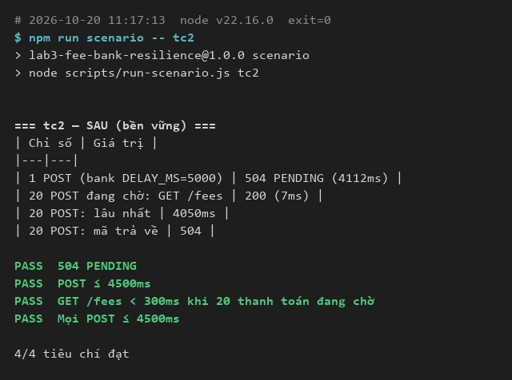

Đọc ảnh: `1 POST` ra `504 PENDING (4112ms)`, `20 POST: lâu nhất` là `4050ms`, đều dưới 4,5s. Fee Service cắt chờ ở deadline 4s tính từ lúc nhận request và giữ lệnh PENDING vì không biết bank có trừ tiền hay không. 4/4 PASS.

---

## TH3 — Giữ kết nối

**Bối cảnh.** Nhiều thanh toán chạy liên tục. Mở một kết nối TCP mới cho mỗi request rất tốn tài nguyên; cần dùng lại kết nối (keep-alive) nhưng không được dính socket bank đã đóng khi nhàn rỗi.

**Thiết lập.** Bank chạy bình thường, không gây lỗi.

**Script làm gì:**

| Dòng trong bảng | Bước script thực hiện |
|---|---|
| `200 POST, 10 song song: thành công` | Gửi 200 thanh toán 1.000đ, luôn giữ 10 request chạy cùng lúc, đếm số 201 |
| `Tổng thời gian` | Thời gian chạy hết 200 thanh toán |
| `Số kết nối TCP Fee Service mở tới bank` | Hiệu số `/stats.connections` của bank trước và sau đợt 200 thanh toán, trừ 1 kết nối do chính lời gọi `/stats` mở. Số này chỉ gồm kết nối của Fee Service |
| `Sau 6,5s nhàn rỗi: 3 POST` | Nghỉ 6,5s (lâu hơn 5s bank giữ kết nối nhàn rỗi), gửi tiếp 3 thanh toán |

**Tiêu chí đạt:** 200/200 thành công; số kết nối TCP không quá 20; sau khi nghỉ vẫn thanh toán được.

**Trước** (`npm run scenario -- tc3 --naive`):

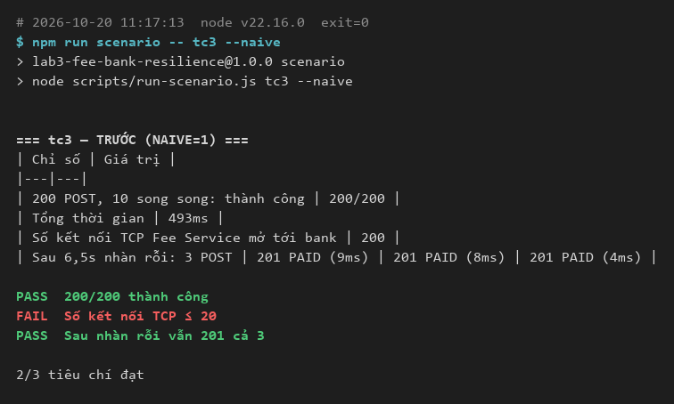

Đọc ảnh: số kết nối là `200`, mỗi thanh toán mở một kết nối riêng, nên dòng `Số kết nối TCP ≤ 20` FAIL. Thanh toán vẫn thành công cả 200 và cả 3 lần sau khi nghỉ.

**Sau** (`npm run scenario -- tc3`):

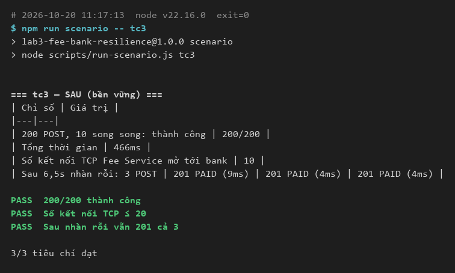

Đọc ảnh: số kết nối là `10`, bằng `maxSockets` của pool, và 200 thanh toán đều thành công. Ba thanh toán sau khi nghỉ 6,5s vẫn ra `201 PAID`: socket nhàn rỗi tự đóng sau 4s, trước mốc 5s của bank, nên không dùng nhầm socket đã chết. 3/3 PASS.

Lưu ý: tiêu chí `Sau nhàn rỗi vẫn 201 cả 3` PASS ở cả hai bản, nên tiêu chí này không phân biệt được trước/sau.

---

## TH4a — Đứt kết nối sau khi bank đã trừ tiền

**Bối cảnh.** Đây là tình huống nguy hiểm nhất: bank trừ tiền xong nhưng kết nối đứt trước khi kịp trả lời. Fee Service không biết tiền đã bị trừ chưa. Nếu gửi lại mà bank trừ lần nữa thì sinh viên mất tiền hai lần.

**Thiết lập.** Bank chạy với `DROP_RATE=0.3`: trừ tiền xong, rồi với xác suất 30% đóng kết nối mà không trả lời.

**Script làm gì:** gửi lần lượt 60 thanh toán 1.000đ (xong cái này mới gửi cái sau), rồi so số liệu hai phía.

| Dòng trong bảng | Ý nghĩa |
|---|---|
| `DROP_RATE=0.3: PAID` | Số lệnh Fee Service ghi nhận đã trừ tiền, trên 60 |
| `503 FAILED` / `504 PENDING` / `mã khác` | Số lệnh trả 503, trả 504, và các mã khác với mã kỳ vọng |
| `Lâu nhất` | Thời gian thanh toán chậm nhất |
| `/stats.charges` | Số lần bank thực sự trừ tiền |
| `/stats.duplicates` | Số lần bank trừ tiền hai lần cho cùng một mã lệnh |
| `Bank đã trừ nhưng Fee không ghi nhận` | `/stats.charges` trừ số PAID: tiền bị trừ thật nhưng Fee Service không biết |
| `Công nợ giảm` | Công nợ giảm bao nhiêu, so với tổng tiền các lệnh PAID |

**Tiêu chí đạt:** `duplicates = 0`; ít nhất 54/60 PAID; lệnh còn lại trả 504; công nợ giảm đúng tổng tiền các lệnh PAID.

**Trước** (`npm run scenario -- tc4a --naive`):

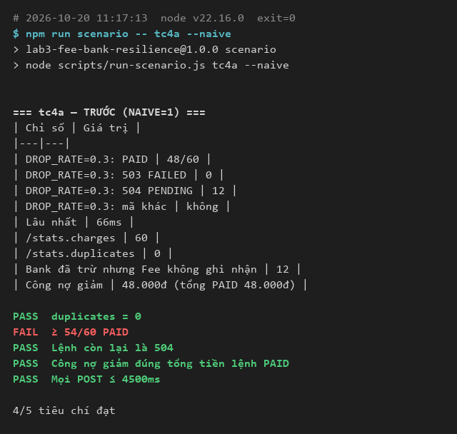

Đọc ảnh: `/stats.charges` là `60` nhưng `PAID` chỉ `48/60`, nên `Bank đã trừ nhưng Fee không ghi nhận` là `12`: 12 lệnh bị trừ tiền thật nhưng Fee Service vẫn để PENDING. Dòng `≥ 54/60 PAID` FAIL. `duplicates = 0` ở bản này không có nghĩa là an toàn: bản này không gửi lại nên không có lần gọi thứ hai để tạo trùng. Vấn đề của nó là lệch dữ liệu giữa hai phía.

**Sau** (`npm run scenario -- tc4a`):

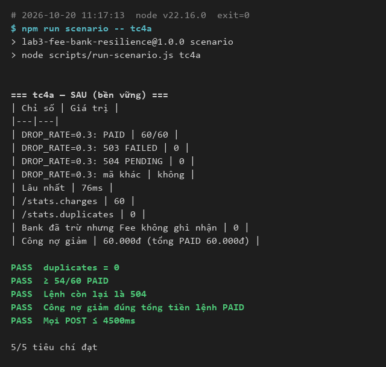

Đọc ảnh: `PAID` là `60/60`, `/stats.charges` là `60` và `/stats.duplicates` là `0`. Fee Service gửi lại cùng `Idempotency-Key`; bank nhận ra mã đã xử lý và trả lại kết quả cũ thay vì trừ tiền lần nữa. Công nợ giảm `60.000đ`, khớp tổng PAID. 5/5 PASS.

---

## TH4b — Bank trả lỗi 500

**Bối cảnh.** Bank gặp lỗi nội bộ thoáng qua và trả HTTP 500. Khác TH4a ở chỗ lỗi xảy ra **trước khi trừ tiền**, nên gửi lại là an toàn.

**Thiết lập.** Bank chạy với `FAIL_RATE=0.3`: 30% request trả 500 mà chưa trừ tiền.

**Script làm gì:** giống TH4a, gửi lần lượt 60 thanh toán 1.000đ. Các dòng trong bảng có cùng ý nghĩa như TH4a.

**Tiêu chí đạt:** ít nhất 54/60 PAID; `duplicates = 0`; lệnh còn lại trả 503 (bank lỗi, chắc chắn chưa trừ tiền).

**Trước** (`npm run scenario -- tc4b --naive`):

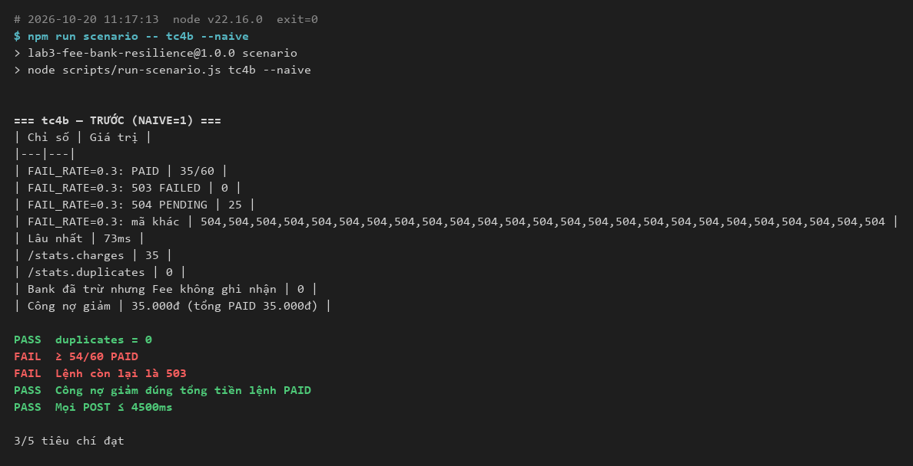

Đọc ảnh: `PAID` là `35/60`, `504 PENDING` là `25`. Dòng `mã khác` liệt kê 25 mã 504: dòng này gom mọi mã khác 201 và khác mã kỳ vọng (503), nên với bản "Trước" nó không rỗng và đó là bình thường. Bản này không gửi lại và không phân biệt được lỗi 5xx (chắc chắn chưa trừ tiền) với lỗi "không rõ", nên 25 lệnh bị giữ PENDING dù bank chưa trừ đồng nào. `Bank đã trừ nhưng Fee không ghi nhận` là `0`, đúng với bản chất lỗi 500. Hai dòng FAIL: `≥ 54/60 PAID` và `Lệnh còn lại là 503`.

**Sau** (`npm run scenario -- tc4b`):

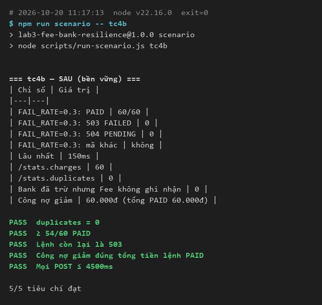

Đọc ảnh: `PAID` là `60/60`. Mỗi lệnh được gọi tối đa 3 lần cùng `Idempotency-Key`, và lỗi 500 được thử lại. Xác suất một lệnh hỏng cả 3 lần là 0,3³ = 2,7%, nên một lần chạy vẫn có thể còn vài lệnh 503 (các lần chạy khác trong lúc phát triển ra 57 và 58 PAID). `/stats.charges` bằng `PAID` và `duplicates = 0`. 5/5 PASS.

---

## TH4c — Vượt hạn mức

**Bối cảnh.** Bank từ chối thật vì số tiền vượt hạn mức 20.000.000đ. Gửi lại sẽ vẫn bị từ chối, nên Fee Service không được thử lại.

**Thiết lập.** Bank chạy bình thường.

**Script làm gì:** gửi 1 thanh toán 25.000.000đ rồi đọc `/stats.requests` của bank.

**Tiêu chí đạt:** Fee Service trả 402; bank chỉ nhận đúng 1 request.

**Trước** (`npm run scenario -- tc4c --naive`):

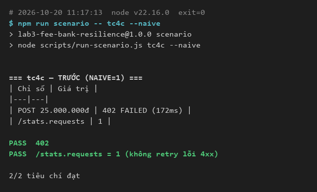

**Sau** (`npm run scenario -- tc4c`):

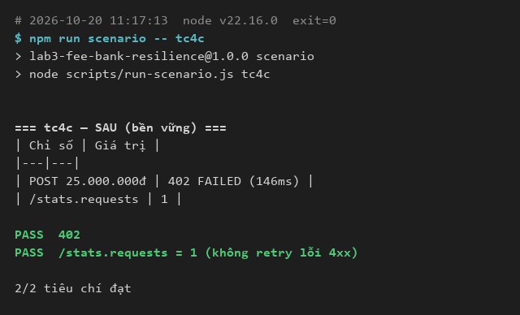

Đọc ảnh: cả hai bản đều ra `402 FAILED` và `/stats.requests` là `1`. Lỗi 4xx được coi là bị từ chối thật nên bản "Sau" cũng không gửi lại. Tình huống này không có chênh lệch trước/sau; nó chứng minh việc retry không áp dụng bừa cho mọi lỗi.

## Cách đo và chạy lại

| Mục | Giá trị |
|---|---|
| Môi trường | Windows, Node v22.16.0, Express 4 |
| Thời điểm chạy | 2026-10-20 11:17 (cả 12 lượt chạy liên tiếp trong một lần) |

Mỗi lần chạy script tự bật bank và Fee Service rồi tắt cả hai, nên dữ liệu (công nợ, lệnh thanh toán) luôn bắt đầu từ đầu.

```
cd Lab3
npm install
npm run scenario -- tc1            # bản "Sau"
npm run scenario -- tc1 --naive    # bản "Trước"
```

Các tình huống: `tc1`, `tc2`, `tc3`, `tc4a`, `tc4b`, `tc4c`. Số liệu TH4a/TH4b là ngẫu nhiên nên sẽ khác lần chạy trong ảnh.

## Giới hạn

- **Mỗi tình huống chỉ chạy 1 lần cho mỗi chế độ.** `DROP_RATE` và `FAIL_RATE` là ngẫu nhiên. Qua 3 lần chạy trong lúc phát triển, TH4a "Trước" ra 37, 40, 48 PAID; TH4b "Trước" ra 41, 44, 35; TH4b "Sau" ra 58, 57, 60. Chỉ lần mới nhất có log trong `evidence/`; các số còn lại ghi lại từ output lúc chạy và không có file kèm theo.
- **Thời gian đo trên máy local.** Độ trễ vài chục đến vài trăm ms thay đổi theo máy, chỉ so sánh được trong cùng một lần chạy.
- **Bản "Trước" không sập.** Plan dự kiến bản này có thể làm Fee Service sập khi bank tắt, nhưng `chargeNaive` luôn resolve và không ném lỗi, nên TH1 chỉ cho thấy trả sai mã (504 thay vì 503).
- **Lệnh PENDING chưa được đối soát.** Sau TH2 và TH4a, các lệnh PENDING vẫn giữ nguyên, vì đối soát nằm ngoài phạm vi của lab này.
- **Số kết nối ở TH3 là số phía bank đếm** qua `server.on('connection')`, không phải số socket mà Node của Fee Service giữ.
